# Manual de usuario · KOOLT Operación

*Guía para el dueño de la heladería y el personal de mostrador.*

---

## Contenido

1. Qué es la aplicación y para qué sirve
2. Quién la usa y qué ve cada uno
3. Qué se necesita para usarla
4. Cómo entrar y cambiar de usuario
5. Las pantallas, una por una
6. Tareas comunes paso a paso
7. Errores frecuentes y qué hacer
8. Glosario

---

## 1. Qué es la aplicación y para qué sirve

KOOLT Operación es la herramienta del día a día de la heladería.

Reemplaza la libreta de ventas y el Excel.

Con ella usted puede:

- Registrar cada venta en el momento en que se cobra.
- Hacer el cierre del día en segundos.
- Saber cuánto queda de cada ingrediente, sin ir a contar.
- Recibir un aviso antes de que algo se acabe.
- Armar los pedidos a los proveedores con las cantidades ya calculadas.
- Ver qué se vende más, qué día y a qué hora.

Cada venta descuenta sola los ingredientes que usa.

Por ejemplo: un helado de vainilla de 12 oz descuenta la base de yogurt, la leche, el vaso, la cuchara y la servilleta.

Así el inventario siempre está al día, sin que nadie tenga que anotarlo.

---

## 2. Quién la usa y qué ve cada uno

Hay dos tipos de usuario.

### Mostrador

Es la persona que atiende y cobra.

Ve solo dos pantallas:

- **Venta**: para cobrar.
- **Cierre diario**: para ver cómo va el día y cerrar la caja.

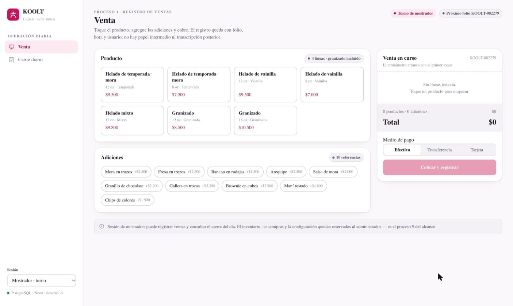

### Administrador

Es el dueño o quien maneja el negocio.

Ve todo lo del mostrador y, además:

- **Inventario**: cuánto hay de cada cosa.
- **Compras**: qué pedir y a quién.
- **Analítica**: gráficas de ventas.
- **Métricas del piloto**: cómo va el uso de la aplicación.
- **Catálogo y recetas**: precios y qué lleva cada producto.

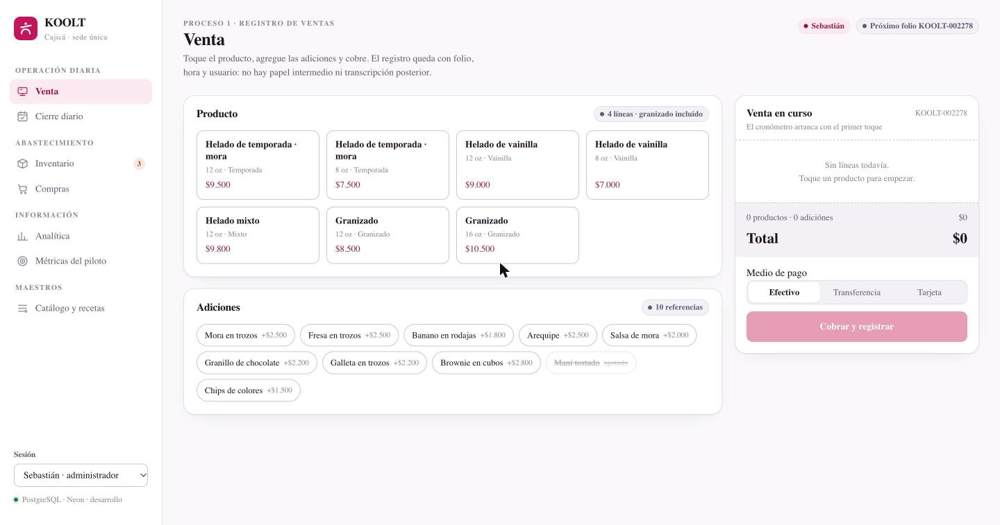

---

## 3. Qué se necesita para usarla

- Un celular, una tableta o un computador.
- Conexión a internet (wifi o datos).
- Abrir este enlace: **https://mvp-ti.vercel.app**

No hay que instalar nada.

Funciona en Chrome, Safari o Edge.

**Consejo:** guarde el enlace en la pantalla de inicio del celular o en favoritos del computador. Así lo abre con un solo toque.

En el celular, el menú aparece arriba, en forma de botones:

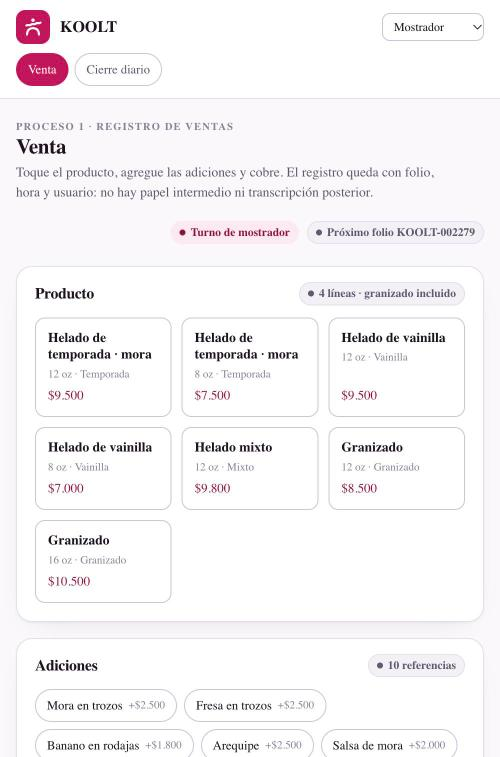

---

## 4. Cómo entrar y cambiar de usuario

### Entrar

1. Abra **https://mvp-ti.vercel.app**.
2. La aplicación abre directo en la pantalla **Venta**.
3. Listo. No se pide contraseña.

### Cambiar de usuario

En el computador, el selector está abajo a la izquierda, donde dice **Sesión**.

En el celular, está arriba a la derecha.

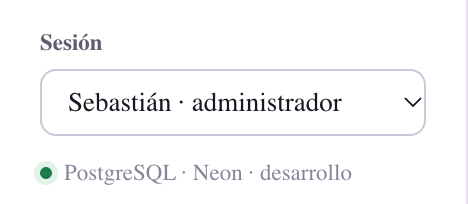

1. Toque el selector.
2. Elija **Mostrador · turno** para atender.
3. Elija **Sebastián · administrador** para ver todo.
4. La pantalla cambia sola en un momento.

**Importante:** si cambia a Mostrador estando en una pantalla de administrador, la aplicación lo lleva a **Venta**.

**Recomendación para el dueño:** acuerden con el equipo que en el mostrador siempre se trabaje con la sesión **Mostrador · turno**.

---

## 5. Las pantallas, una por una

### 5.1 Venta

Es la pantalla para cobrar. Es la que más se usa.

Tiene tres partes:

- **Producto** (arriba a la izquierda): los helados y granizados con su tamaño y precio.
- **Adiciones** (abajo a la izquierda): los toppings con su precio extra.
- **Venta en curso** (a la derecha): lo que lleva el cliente, el total, el medio de pago y el botón para cobrar.

Arriba a la derecha aparece el **folio** de la próxima venta, por ejemplo KOOLT-002278.

Hay un cronómetro que mide cuánto se tarda en registrar cada venta. La meta es menos de 30 segundos. No se preocupe por él: solo sirve para medir.

Un topping **tachado** y con la palabra **agotado** no se puede vender, porque ya no queda.

Después de cobrar, aparece abajo el **Último comprobante** con el folio, la hora, el total y el medio de pago.

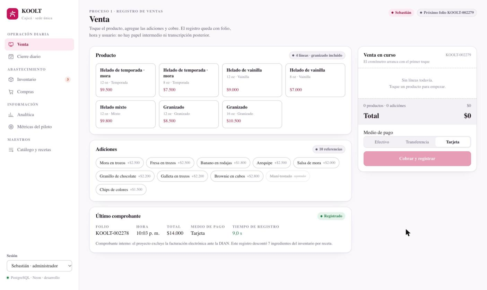

### 5.2 Cierre diario

Muestra cómo va el día y permite cerrar la caja.

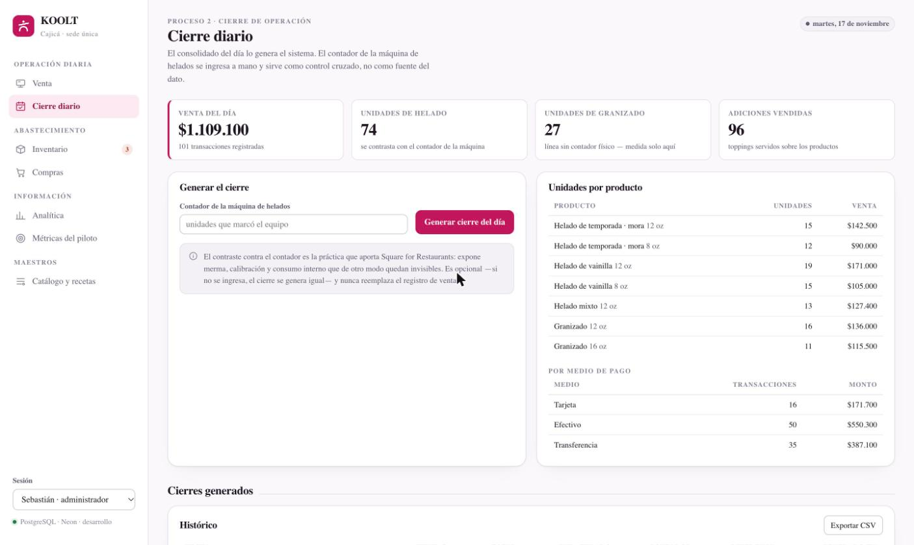

Arriba hay cuatro recuadros:

- **Venta del día**: el total vendido y cuántas ventas fueron.
- **Unidades de helado**: cuántos helados se vendieron.
- **Unidades de granizado**: cuántos granizados se vendieron.
- **Adiciones vendidas**: cuántos toppings se sirvieron.

A la derecha, **Unidades por producto** y **Por medio de pago** (efectivo, transferencia y tarjeta).

Abajo está el **Histórico** con los cierres de los días anteriores.

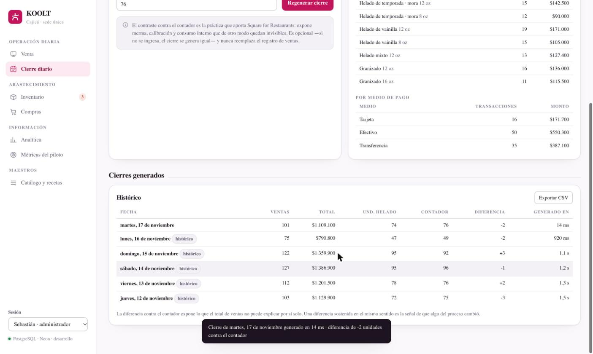

### 5.3 Inventario *(solo administrador)*

Muestra cuánto hay de cada ingrediente y de cada desechable.

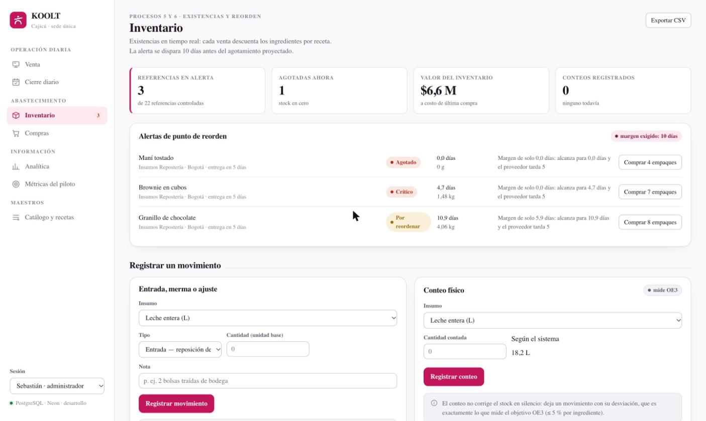

Arriba, cuatro recuadros:

- **Referencias en alerta**: cuántas cosas hay que pedir pronto.
- **Agotadas ahora**: cuántas se acabaron.
- **Valor del inventario**: cuánto vale lo que hay.
- **Conteos registrados**: cuántas veces se ha contado a mano.

Luego vienen las **Alertas de punto de reorden**: la lista de lo que hay que pedir. Cada una trae un botón para ir a comprarlo.

Los colores de cada producto significan:

- **Verde · En nivel**: todo bien.
- **Amarillo · Por reordenar**: toca pedir.
- **Rojo · Crítico**: queda muy poco, pida ya.
- **Rojo · Agotado**: se acabó.

Más abajo están los formularios para registrar **entradas**, **mermas**, **ajustes** y **conteos**. Se explican en la sección 6.

Luego, **Existencias**: la lista completa, con cuánto queda y para cuántos días alcanza.

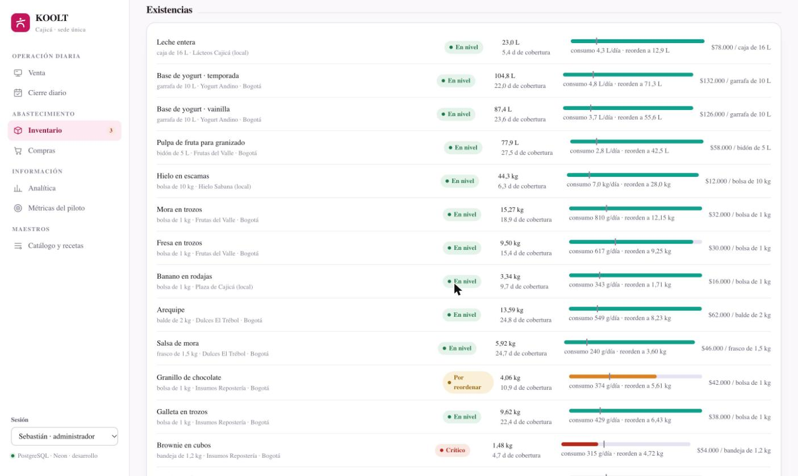

Al final hay una gráfica de **Cobertura por insumo**: cada barra muestra para cuántos días alcanza lo que hay. La rayita vertical marca el momento en que conviene pedir.

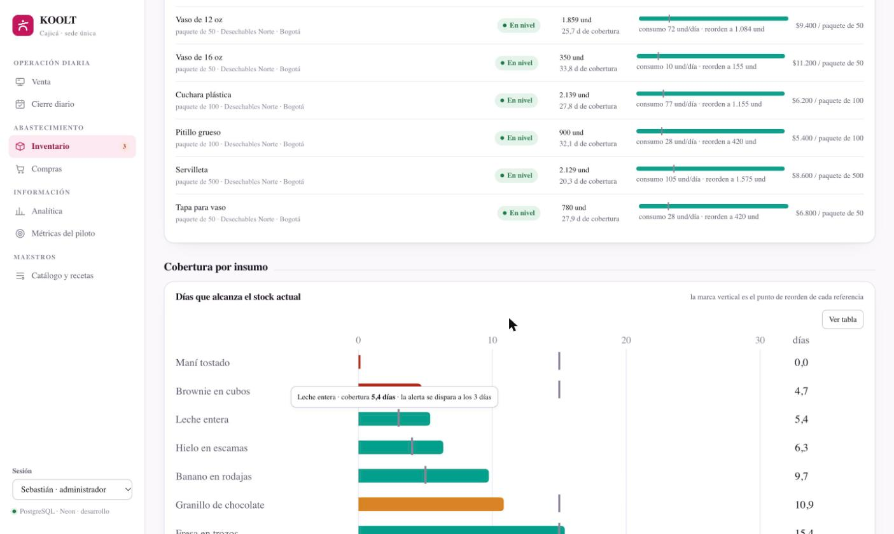

### 5.4 Compras *(solo administrador)*

Le dice qué pedir, cuánto y a qué proveedor.

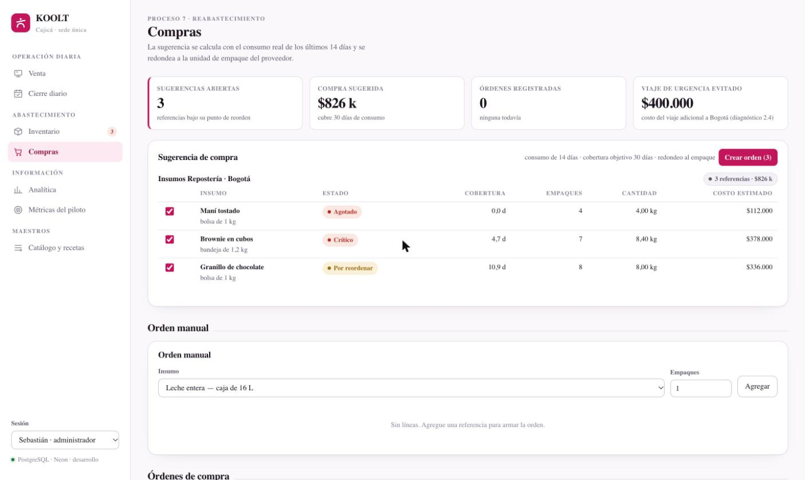

- **Sugerencia de compra**: la aplicación calcula la cantidad según lo que se ha vendido en las últimas dos semanas. Alcanza para 30 días y ya viene redondeada a bolsas, cajas o paquetes completos.
- **Orden manual**: para pedir algo que no está en la sugerencia.
- **Órdenes de compra**: la lista de pedidos hechos, con su estado (**Enviada** o **Recibida**).

### 5.5 Analítica *(solo administrador)*

Gráficas para entender el negocio.

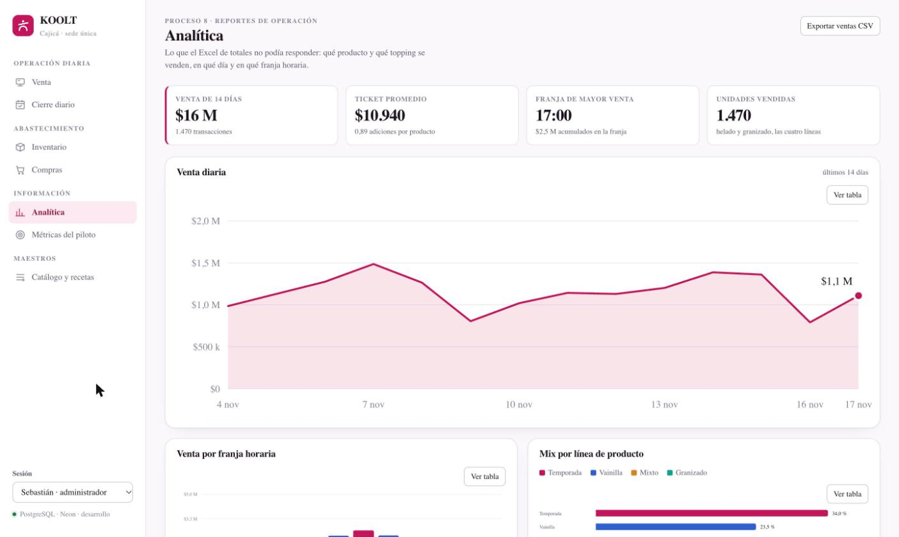

- **Venta diaria**: cuánto se vendió cada día de las últimas dos semanas.
- **Venta por franja horaria**: a qué horas se vende más. La barra de color diferente es la hora más fuerte.
- **Mix por línea de producto**: qué parte de la venta es de temporada, vainilla, mixto y granizado.
- **Adiciones más vendidas**: los toppings favoritos de los clientes.

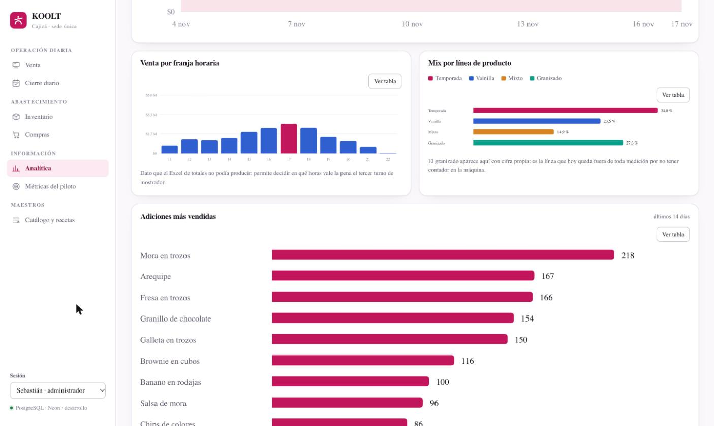

Cada gráfica tiene un botón **Ver tabla** por si prefiere ver los números.

### 5.6 Métricas del piloto *(solo administrador)*

Muestra si la aplicación está cumpliendo las metas que se pusieron al empezar.

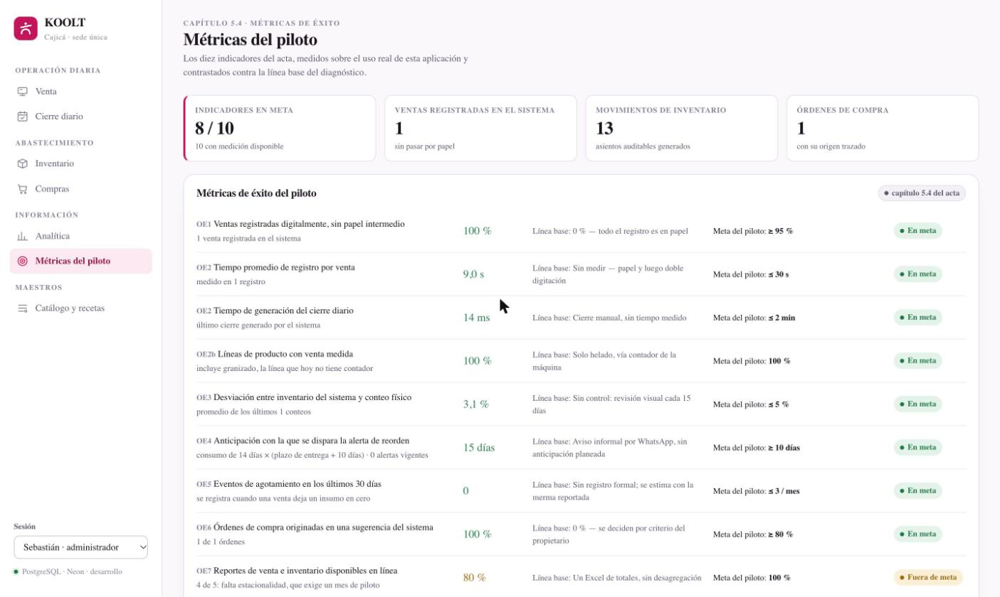

Cada fila es una meta. Por ejemplo: que las ventas se registren en menos de 30 segundos, o que no se acaben ingredientes más de 3 veces al mes.

- **En meta** (verde): se está cumpliendo.
- **Fuera de meta** (amarillo): falta mejorar.
- **Sin medir**: todavía no hay datos.

Abajo está **Capacitación del equipo**. Marque la casilla de cada persona cuando ya sepa usar la aplicación sola.

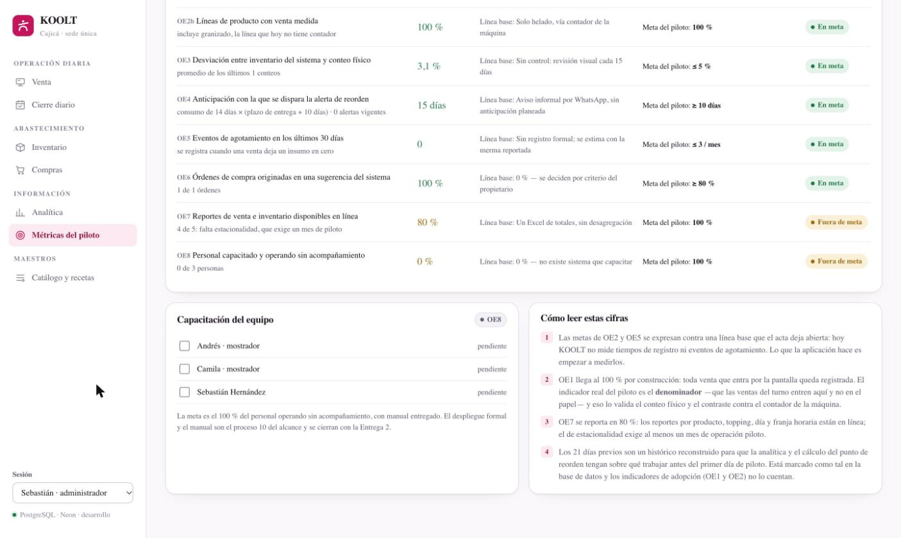

### 5.7 Catálogo y recetas *(solo administrador)*

Aquí están los precios y lo que lleva cada producto.

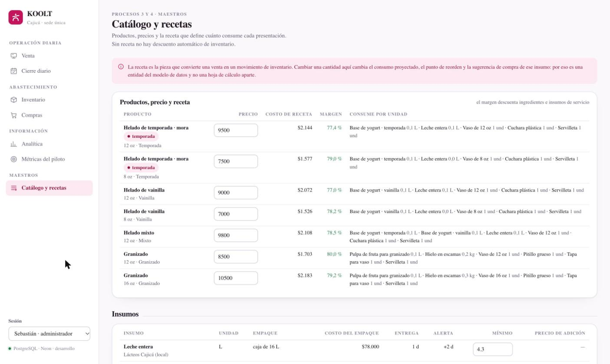

- **Productos, precio y receta**: cada helado y granizado con su precio, lo que cuesta hacerlo, la ganancia (margen) y los ingredientes que gasta.
- **Insumos**: cada ingrediente o desechable, con su empaque, su costo, su proveedor y el **Mínimo** que debe haber.

Los recuadros blancos (precio y mínimo) se pueden cambiar. Ver sección 6.7.

---

## 6. Tareas comunes paso a paso

### 6.1 Registrar una venta con toppings

Ejemplo: un helado de vainilla de 12 oz con mora y arequipe, pagado con tarjeta.

1. Entre a **Venta**.
2. Toque **Helado de vainilla · 12 oz**.
3. Toque **Mora en trozos**.
4. Toque **Arequipe**.
5. Revise a la derecha que todo esté bien y el total sea el correcto.
6. En **Medio de pago**, toque **Tarjeta**.
7. Toque **Cobrar y registrar**.

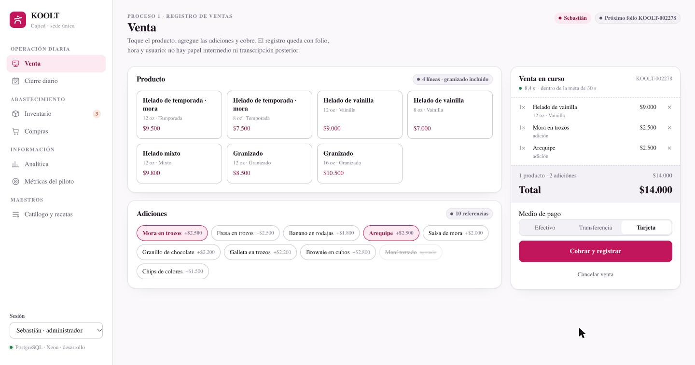

Abajo aparece un mensaje que confirma la venta con su folio.

**Para vender dos iguales:** toque el producto dos veces. A la derecha dirá **2×**.

**Para quitar algo antes de cobrar:** toque la **×** al lado de esa línea.

**Para empezar de nuevo:** toque **Cancelar venta**.

### 6.2 Hacer el cierre del día con el contador de la máquina

Hágalo al cerrar el local, después de la última venta.

1. Mire el contador de la máquina de helados y anote el número de unidades del día.
2. Entre a **Cierre diario**.
3. En **Contador de la máquina de helados**, escriba ese número.
4. Toque **Generar cierre del día**.

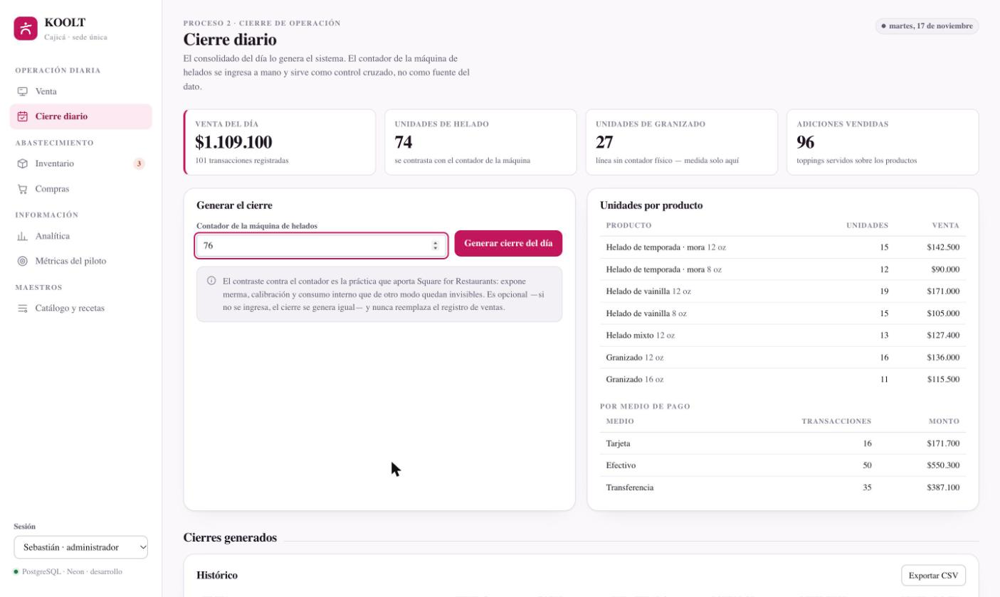

Aparece la marca verde **Día ya cerrado** y un mensaje con la diferencia.

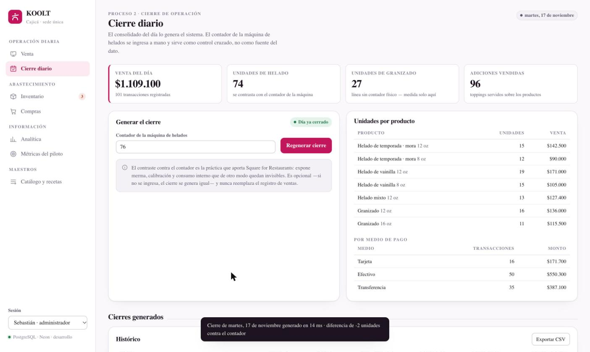

**Cómo leer la diferencia:**

- **0**: la máquina y la aplicación coinciden. Perfecto.
- **Número negativo** (por ejemplo −2): la máquina sirvió más helados de los que se registraron. Puede ser una venta que no se anotó, una prueba o un helado que se botó.
- **Número positivo**: se registraron más helados de los que marcó la máquina. Revise si se cobró algo dos veces.

Una diferencia pequeña de vez en cuando es normal. Si se repite todos los días, vale la pena revisar.

**El contador es opcional.** Si no lo escribe, el cierre se hace igual.

**¿Hubo ventas después de cerrar?** Vuelva a **Cierre diario** y toque **Regenerar cierre**.

### 6.3 Registrar una entrada de mercancía

Úselo cuando traiga producto de la bodega al local, o cuando llegue algo que no pasó por una orden de compra.

Ejemplo: llegaron 6 litros de leche.

1. Entre a **Inventario**.
2. Baje hasta **Registrar un movimiento**.
3. En **Insumo**, elija **Leche entera (L)**.
4. En **Tipo**, elija **Entrada — reposición desde bodega**.
5. En **Cantidad**, escriba **6**.
6. En **Nota**, escriba algo corto, por ejemplo "6 bolsas traídas de bodega".
7. Toque **Registrar movimiento**.

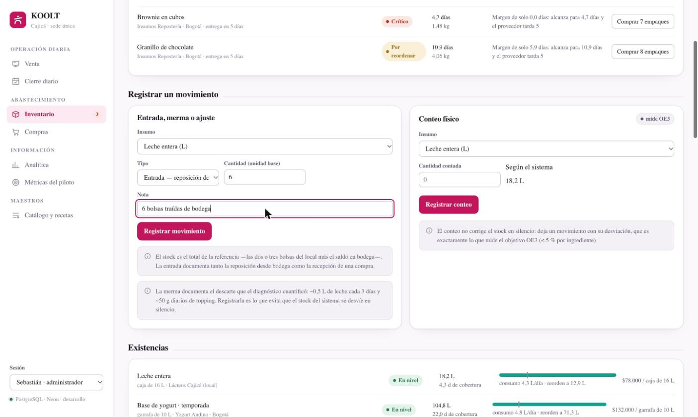

Abajo aparece un mensaje con la cantidad nueva.

**Ojo con la unidad:** la cantidad va en la unidad que aparece entre paréntesis al lado del nombre: litros (L), kilos (kg), gramos (g) o unidades (und).

### 6.4 Registrar una merma

Merma es lo que se bota: algo vencido, dañado o que se cayó.

Ejemplo: se botó medio litro de leche vencida.

1. Entre a **Inventario** y baje hasta **Registrar un movimiento**.
2. En **Insumo**, elija **Leche entera (L)**.
3. En **Tipo**, elija **Merma — vencimiento o descarte**.
4. En **Cantidad**, escriba **0.5** (use punto para los decimales).
5. En **Nota**, escriba el motivo, por ejemplo "Leche vencida".
6. Toque **Registrar movimiento**.

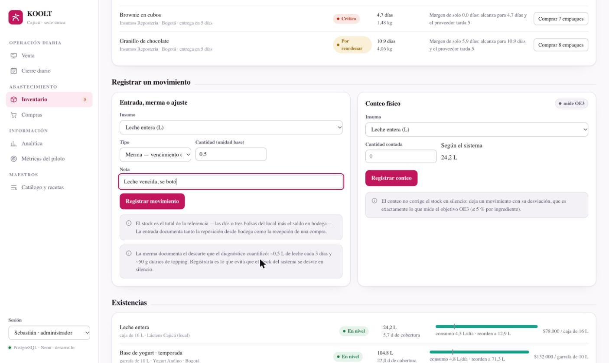

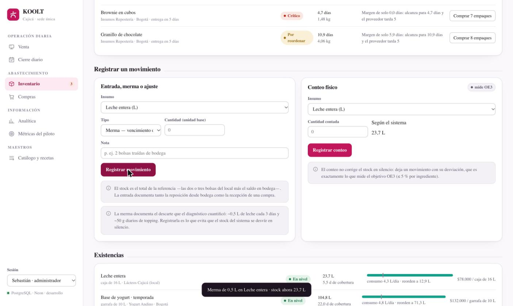

Registrar las mermas es importante. Si no se anotan, la aplicación creerá que hay más de lo que de verdad hay.

### 6.5 Hacer un conteo físico

Sirve para comprobar que lo que dice la aplicación es lo que hay de verdad.

1. Cuente a mano el producto: bolsas, cajas, kilos, lo que corresponda.
2. Entre a **Inventario** y baje hasta **Conteo físico**.
3. En **Insumo**, elija el producto que contó.
4. Al lado verá **Según el sistema**: lo que la aplicación cree que hay.
5. En **Cantidad contada**, escriba lo que usted contó.
6. Toque **Registrar conteo**.

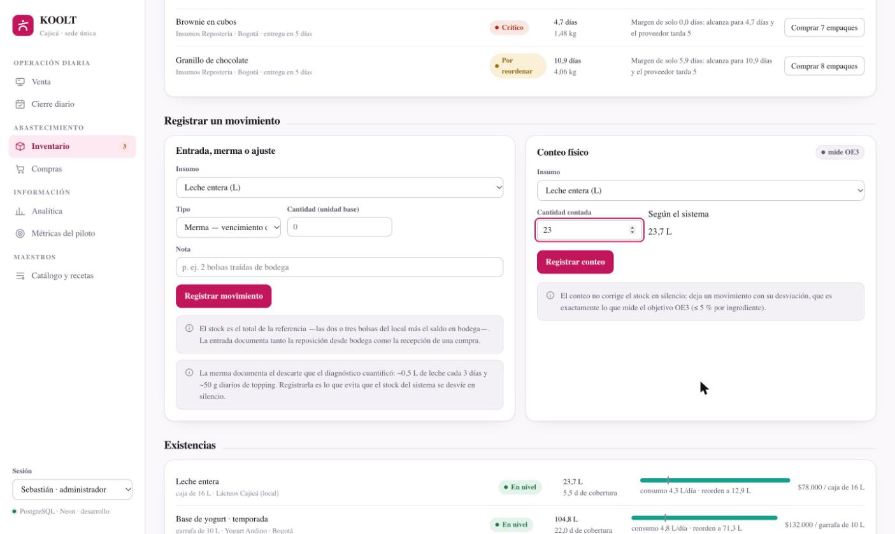

Aparece una tablita con la **Desviación**: la diferencia entre lo contado y lo que decía la aplicación.

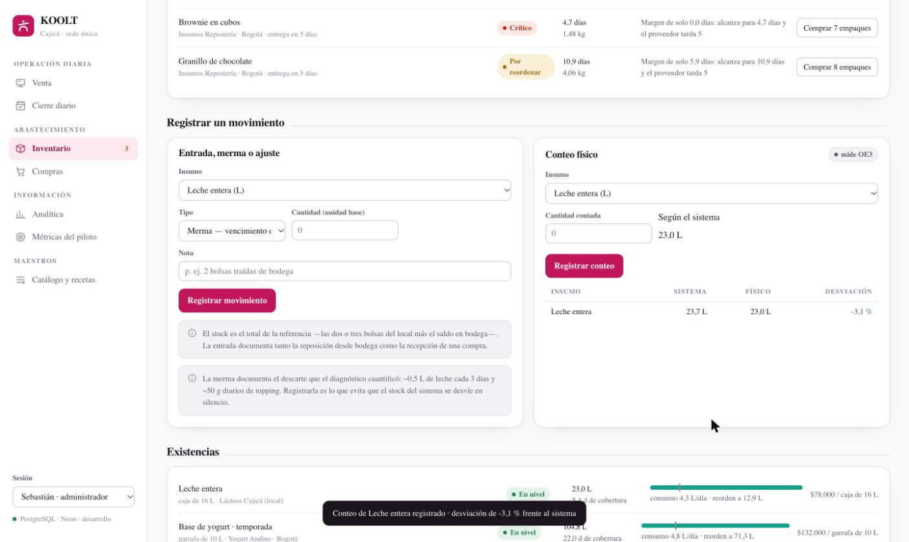

- **En verde**: la diferencia es pequeña (5 % o menos). Todo bien.
- **En rojo**: la diferencia es grande. Revise si faltó anotar mermas o entradas.

Después del conteo, la aplicación queda con la cantidad que usted contó.

### 6.6 Crear una orden de compra desde la sugerencia y recibirla

**Crear la orden**

1. Entre a **Compras**.
2. Mire la **Sugerencia de compra**. Está agrupada por proveedor.
3. Revise las casillas de la izquierda. Quite la marca de lo que no quiera pedir.
4. Toque **Crear orden** (arriba a la derecha). Entre paréntesis dice cuántos productos lleva.

Abajo aparece un mensaje con el número de la orden, por ejemplo OC-001.

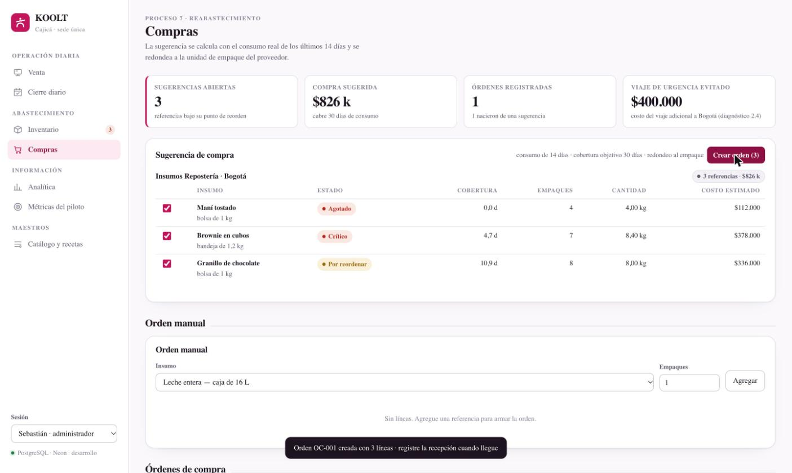

**Toque Crear orden una sola vez.** La sugerencia sigue en pantalla hasta que la mercancía llegue; eso es normal.

5. Haga el pedido al proveedor como siempre (por teléfono o WhatsApp), con las cantidades que muestra la orden.

La orden queda en la lista **Órdenes de compra** con el estado **Enviada**.

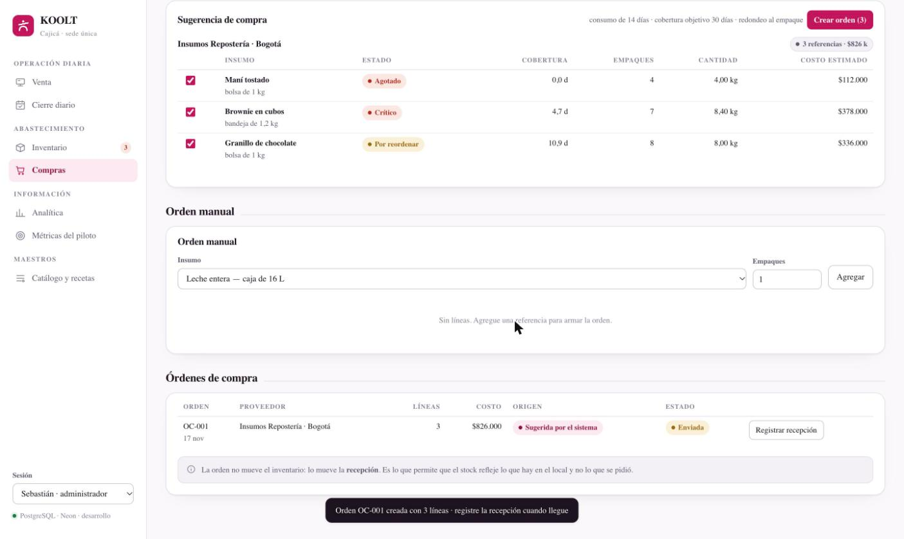

**Recibir la orden**

Cuando llegue la mercancía:

1. Revise que llegó completa.
2. Entre a **Compras** y baje hasta **Órdenes de compra**.
3. En la orden que llegó, toque **Registrar recepción**.

El estado cambia a **Recibida** y la mercancía se suma sola al inventario.

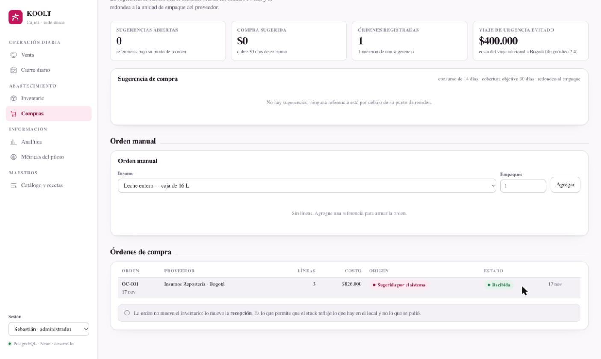

**No registre también una entrada en Inventario** para la misma mercancía. Se sumaría dos veces.

### 6.7 Cambiar un precio

Ejemplo: el helado de vainilla de 12 oz pasa de $9.000 a $9.500.

1. Entre a **Catálogo y recetas**.
2. Busque el producto en la tabla.
3. Toque el recuadro del **Precio**.
4. Borre el número y escriba el nuevo, sin puntos ni signo: **9500**.
5. Toque la tecla **Enter**, o toque en cualquier otra parte de la pantalla.

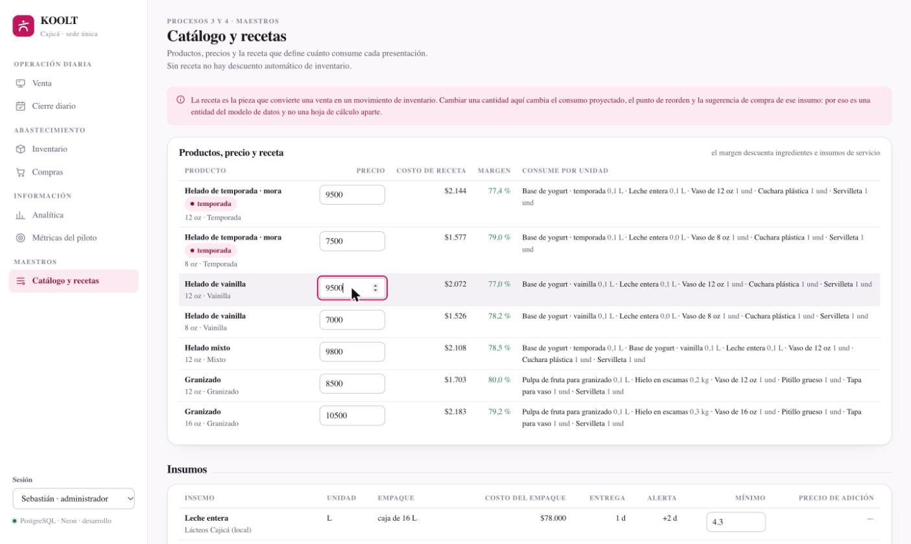

Abajo aparece el mensaje **Precio actualizado**.

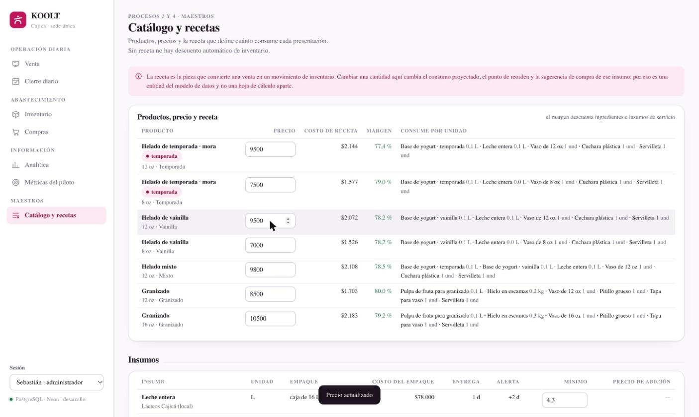

El precio nuevo aparece de una vez en la pantalla de Venta.

El **Mínimo** de cada insumo se cambia igual, en la tabla de **Insumos**.

### 6.8 Exportar un reporte

Sirve para enviar la información a contaduría o abrirla en Excel.

Hay tres reportes. Cada uno tiene su botón:

| Reporte | Dónde está el botón | Nombre del botón |
|---|---|---|
| Todas las ventas | **Analítica**, arriba a la derecha | Exportar ventas CSV |
| Cierres de cada día | **Cierre diario**, en el Histórico | Exportar CSV |
| Inventario actual | **Inventario**, arriba a la derecha | Exportar CSV |

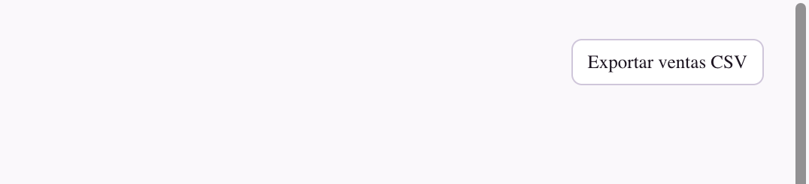

1. Entre a la pantalla del reporte que necesita.
2. Toque el botón **Exportar**.
3. El archivo se descarga solo (por ejemplo, *koolt-ventas.csv*).
4. Ábralo con Excel. Ya viene listo, con columnas separadas.

---

## 7. Errores frecuentes y qué hacer

### Un topping aparece tachado o dice "agotado"

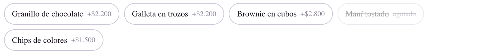

- Quiere decir que la aplicación cree que ya no queda.
- Ofrézcale al cliente otro topping.
- Avise al administrador.
- Si sí queda producto, el administrador debe hacer un **conteo físico** (6.5) o registrar una **entrada** (6.3). Así se habilita de nuevo.

### Un producto dice "falta…" en naranja

- Falta uno de sus ingredientes.
- Avise al administrador para que revise el inventario.

### La aplicación tarda en cargar la primera vez

- Es normal la primera vez del día o tras un rato sin uso. Puede tardar unos segundos.
- Espere un momento.
- Si no carga en medio minuto, recargue la página.
- Las siguientes veces abre rápido.

### Se cayó el internet

- La aplicación necesita internet para guardar las ventas.
- Si toca **Cobrar y registrar** sin conexión, sale un aviso de que no se pudo registrar. La venta **no** queda guardada.
- Mientras vuelve la conexión, anote cada venta en papel: hora, producto, toppings, total y medio de pago.
- Cuando vuelva el internet, regístrelas una por una en **Venta**.
- Si no vuelve pronto, pruebe con los datos del celular.

### Me equivoqué en una venta

**Si todavía no ha cobrado:**

- Toque la **×** al lado de lo que sobra, o
- Toque **Cancelar venta** y empiece de nuevo.

**Si ya cobró:**

- La venta ya quedó guardada y no se puede borrar desde el mostrador.
- Anote el **folio** del comprobante (por ejemplo KOOLT-002278) y qué estuvo mal.
- Avise al administrador.
- No registre la venta otra vez "para corregir". Quedaría doble.

### Toqué "Cobrar" dos veces

- Mire el comprobante y el folio.
- Si salieron dos folios para el mismo cliente, anote ambos y avise al administrador.

### No veo el menú de administrador

- Seguramente la sesión está en **Mostrador · turno**.
- Abajo a la izquierda (o arriba a la derecha en el celular), cambie la sesión a **Sebastián · administrador**.
- El menú completo aparece en un momento.

### Escribí una cantidad y no pasa nada

- Revise que escribió un número mayor que cero.
- Para decimales use punto: **0.5**, no 0,5.
- Lea el mensaje que aparece abajo en la pantalla: explica qué faltó.

### El conteo físico salió en rojo

- Hay mucha diferencia entre lo contado y lo que creía la aplicación.
- Revise si faltó registrar alguna merma o alguna entrada.
- Vuelva a contar si tiene dudas.

---

## 8. Glosario

**Punto de reorden**
Es la cantidad a la que conviene hacer el pedido. Se calcula para que la mercancía alcance a llegar antes de que se acabe. Cuando un producto baja de ese punto, aparece en las alertas y en la sugerencia de compra.

**Merma**
Lo que se pierde sin venderse: producto vencido, dañado o que se botó.

**Cobertura**
Para cuántos días alcanza lo que hay, al ritmo de venta normal. Por ejemplo, "5,4 días de cobertura" quiere decir que alcanza para unos cinco días.

**Folio**
El número único de cada venta, por ejemplo KOOLT-002278. Sirve para encontrarla después si hay algún reclamo o error.
